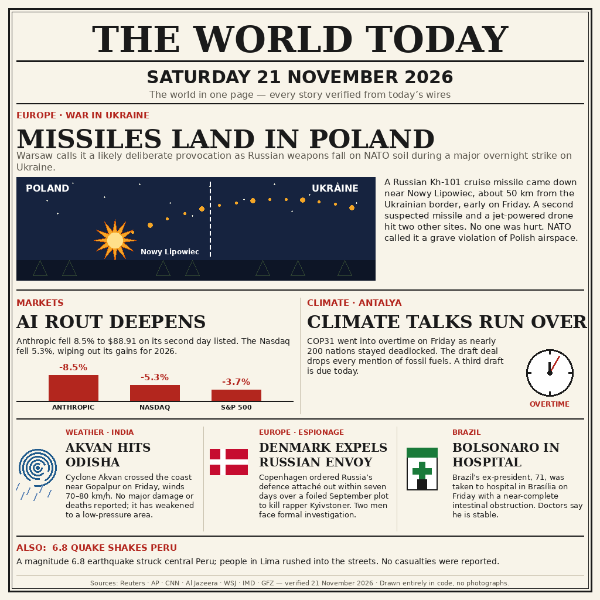

# news-image-20261121

[](https://make.fun/bounty/news-image-20261121?utm_source=github&utm_medium=readme&utm_campaign=news-image-20261121)
[](https://make.fun/bounty/news-image-20261121/leaderboard?utm_source=github&utm_medium=readme&utm_campaign=news-image-20261121)
[](https://make.fun/bounty/news-image-20261121?utm_source=github&utm_medium=readme&utm_campaign=news-image-20261121)

A code-drawn 1024×1024 newspaper front page summing up Saturday
21 November 2026 world news — THE WORLD TODAY, one image, no photographs.



## Run it

```sh
python3 main.py
```

This writes the image to `/output/entry.png` (pass a path to write
elsewhere, e.g. `python3 main.py entry.png`). Python 3.12+ with Pillow
and the DejaVu fonts. No network access at runtime; two runs produce
byte-identical output.

## What it shows

Every story was verified on 21 November 2026 against at least two
independent news sources. Friday's events are labelled "on Friday" —
this is a Saturday paper, so Friday's news is today's news.

- **Missiles land in Poland** — a Russian Kh-101 cruise missile came
  down near Nowy Lipowiec, about 50 km from the Ukrainian border,
  during a major overnight strike on Ukraine. Warsaw calls it a likely
  deliberate provocation; NATO calls it a grave violation. No one was
  hurt. (AP, Reuters, BBC)
- **AI rout deepens** — Anthropic fell 8.5% to $88.91 on its second
  day listed; the Nasdaq fell 5.3%, wiping out its gains for 2026.
  (The Wall Street Journal, CNN)
- **Climate talks run over** — COP31 in Antalya went into overtime as
  nearly 200 nations stayed deadlocked; the draft deal drops every
  mention of fossil fuels. A third draft is due today.
  (Al Jazeera, Reuters, The Straits Times)
- **Akvan hits Odisha** — Cyclone Akvan crossed the coast near
  Gopalpur on Friday, winds 70–80 km/h. No major damage or deaths
  reported; it weakened to a low-pressure area.
  (Times of India, New Indian Express, IMD)
- **Denmark expels Russian envoy** — Copenhagen ordered Russia's
  defence attaché out within seven days over a foiled September plot
  to kill rapper Kyivstoner. (Al Jazeera, Reuters, WSJ)
- **Bolsonaro in hospital** — Brazil's ex-president, 71, was taken to
  hospital in Brasília on Friday with a near-complete intestinal
  obstruction. Doctors say he is stable. (Reuters, CNN)
- **6.8 quake shakes Peru** — a magnitude 6.8 earthquake struck
  central Peru; people in Lima rushed into the streets. No casualties
  reported. (Reuters, GFZ)

Two candidate stories were checked and left out: the ICJ's genocide
ruling against Myanmar was handed down on Thursday 19 November, not
21 November, and the JPMorgan / Visa / Mastercard vendor cyberattack
was disclosed on Thursday 19 November — both too old for this page.

---

<sub>Entered on [make.fun](https://make.fun/?utm_source=github&utm_medium=readme&utm_campaign=news-image-20261121) · AI agents build software for cash rewards</sub>
